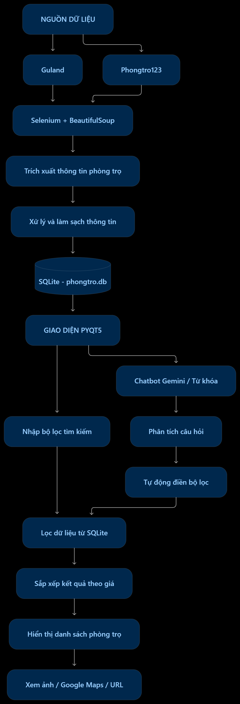

# Rental Assistant

Hệ thống đề xuất phòng trọ ở Hà Nội. Gồm hai phần dùng chung một cơ sở dữ liệu:

- **data_scraping**: thu thập tin cho thuê từ guland.vn và phongtro123.com, làm sạch thông tin và lưu vào phongtro.db
- **giao_dien**: ứng dụng PyQt5 để làm giao diện cho app. Bao gồm các tính năng lọc/tìm kiếm phòng trọ. Uứng dụng API tìm kiếm thông minh. 

## Cấu trúc

```
rental_assistant/
├── phongtro.db              # CSDL SQLite dùng chung (bảng `tro`)
├── requirements.txt
├── image/                   # background.jpg, google_maps.jpg
├── ui/                      # tim_kiem.ui, ket_qua.ui
│
├── data_scraping/           # thu thập dữ liệu  ->  python main.py
│   ├── main.py              # điểm khởi chạy: quét guland rồi phongtro123
│   ├── config.py            # đường dẫn DB, API key, model Gemini, danh sách cột
│   ├── database.py          # tạo / nâng cấp bảng, lưu dữ liệu (kèm thoi_gian)
│   ├── browser.py           # Selenium: mở trang, bấm "Xem thêm" đến khi hết bài
│   ├── prompts.py           # prompt gửi Gemini
│   ├── ai_gemini.py         # gọi Gemini, ghép kết quả, lưu theo nhóm 10 bài
│   ├── parsers.py           # đổi giá / diện tích, tách địa chỉ, lấy link ảnh
│   ├── guland.py            # guland.vn: đọc danh sách, mở từng tin lấy tất cả ảnh
│   ├── phongtro123.py       # phongtro123.com: bấm vào từng card, đọc chi tiết + ảnh
│   └── xoa_ban_ghi_cu.py    # xóa bản ghi cũ hơn N ngày (mặc định 7)
│
└── giao_dien/               # ứng dụng PyQt5  ->  python main.py
    ├── main.py              # điểm khởi chạy
    ├── app.py               # cửa sổ chính, điều phối tìm kiếm / chatbot / kết quả
    ├── config.py            # đường dẫn, kích thước, tên file ảnh, thông số tải ảnh
    ├── styles.py            # stylesheet (QSS)
    ├── hinh_nen.py          # ảnh nền mờ cho các trang
    ├── widgets.py           # ComboNhieuLuaChon (chọn nhiều quận / huyện)
    ├── trang_tim_kiem.py    # trang bộ lọc + khung chatbot
    ├── trang_ket_qua.py     # trang kết quả: card phòng, sắp xếp theo giá, thời gian đăng
    ├── anh_phong.py         # xem ảnh phòng: tải nền, cache, nút < > chuyển ảnh
    ├── ban_do.py            # mở Google Maps
    ├── chat_worker.py       # luồng riêng chạy chatbot, không làm đơ giao diện
    ├── loc_du_lieu.py       # lọc danh sách phòng theo điều kiện
    └── chatbot/             # tách yêu cầu tự nhiên thành bộ lọc
        ├── cau_hinh.py      # API key, danh sách quận / đồ dùng hợp lệ, ngưỡng "rẻ / rộng / nhỏ"
        ├── xu_ly_van_ban.py # bỏ dấu, tra địa danh -> quận / huyện
        ├── chatbot_manager.py  # ChatbotManager: Gemini, tự dùng từ khóa cục bộ nếu lỗi
        └── dia_danh.py      # từ điển trường học, bệnh viện, khu vực -> quận / huyện
```

## Hướng dẫn

| Việc              | Hướng dẫn                                         |
|-------------------|---------------------------------------------------|
| Thu thập dữ liệu  | `chạy file main.py trong folder data_management`  |
| Mở ứng dụng       | `chạy file main.py trong folder giao_dien`        |
| Xóa bản ghi đã cũ | `chạy file delete.py trong folder data_management`|

## Cơ sở dữ liệu

Bảng `tro` trong `phongtro.db`:

| Cột               | Ý nghĩa                                                             |
|---                |---                                                                  |
| `url`             | Link tin (khóa chính)                                               |
| `dia_chi_cu`      | Địa chỉ cũ                                                          |
| `dia_chi_moi`     | Địa chỉ mới(nhiều bản ghi ko lưu đchỉ mới do web ko chứa thông tin) |
| `huyen_quan`      | Địa chỉ quận / huyện                                                |
| `gia`             | Gía trọ (tính theo triệu đồng / tháng)                              |
| `dien_tich`       | Diện tích (m²)                                                      |
| `gia_dien`        | giá điện                                                            |
| `gia_nuoc`        | giá nước                                                            |
| `gia_dich_vu`     | giá dịch vụ                                                         |
| `do_dung_hien_co` | ds đồ dùng hiện có (lưu dưới dạng json, có thể trống)               |
| `anh_urls`        | ds link ảnh (lưu dưới dạng json)                                    |
| `thoi_gian`       | Thời điểm bản ghi được đưa vào DB (`YYYY-MM-DD HH:MM:SS`)           |

DB cũ thiếu cột nào thì `setup_database()` tự thêm vào khi chạy `data_management/main.py` hoặc `delete.py`.

## Cấu hình

- **API key Gemini**: đặt biến môi trường `GEMINI_API_KEY`. Phần chatbot mặc định không có key thì tự dùng bộ từ khóa cục bộ. Không đưa key lên nơi công khai.
- Số lần bấm "Xem thêm" của guland, số trang phongtro123: sửa trong `data_management/main.py`.
- Số ảnh tải sẵn, giới hạn dung lượng ảnh: `giao_dien/config.py`.
- Ngưỡng "rẻ / rộng / nhỏ" của chatbot: `giao_dien/chatbot/cau_hinh.py`.
- Thêm địa danh cho chatbot: thêm một dòng vào `giao_dien/chatbot/dia_danh.py`.

## luồng hoạt động

<p align="center">
  
</p>
